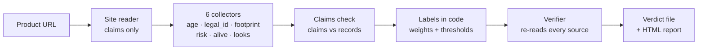
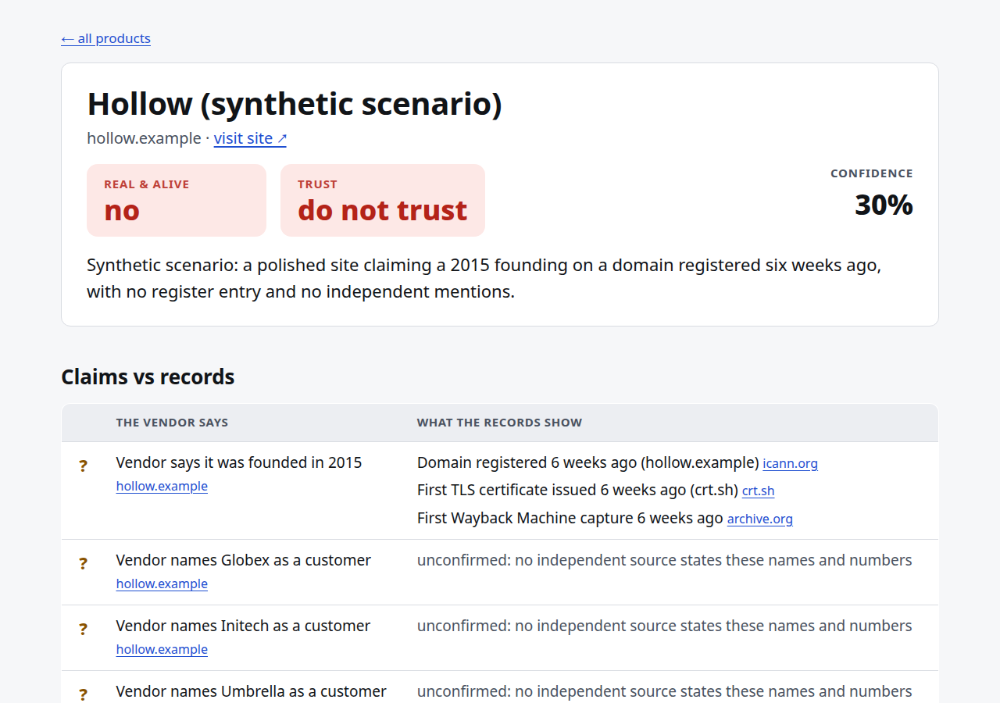
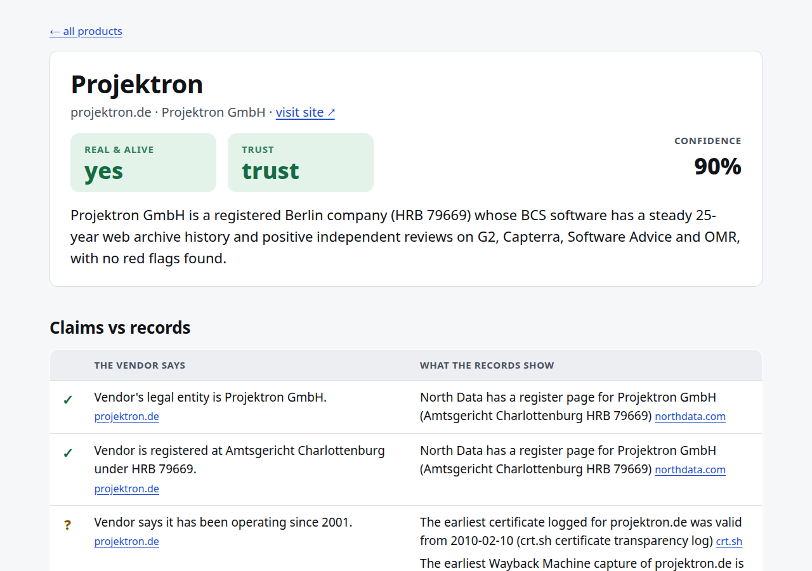

# vet

**Anyone can generate a convincing website. vet checks claims against records.**

## The problem

A polished website, glowing copy and a list of famous customers now take an afternoon to make, so they
say nothing about whether a software vendor is real. Buyers still have to decide whether a product is
alive and whether the company behind it deserves their data and money. Checking that by hand means
digging through domain records, company registers, breach lists and independent mentions for every
vendor.

Give vet a product's URL and it returns:

- **real_alive**: is the product real and still being built? (`yes` / `unclear` / `no`)
- **trust**: would you trust the company with your data and money? (`trust` / `caution` / `do_not_trust`)
- **reasons**: 4–7 short reasons, strongest first, each linked to a page that says what the reason claims.

Built for the Stackgini "Agents with Taste" challenge (AI Agents Berlin, 27 Nov 2026). `SPEC.md` has the
full design and `AGENTS.md` the working rules.

## How it works



- **The vendor's site gives claims, never evidence.** Evidence comes from records (RDAP, certificate logs,
  the Wayback Machine, company registers, Have I Been Pwned) and independent sources. A claim is
  confirmed only when a record states the same number, name, year or identifier.
- **Labels are decided in code.** Each verified fact has a weight and a direction; fixed thresholds turn
  the score into a label. The model only writes the summary and ranks the reasons.
- **Every reason is verified.** Its source is checked again for what the reason says. A reason that fails
  is dropped, and the labels are recomputed without it. A search tool's own page (such as Tavily's
  generated company profiles) is never a source.
- **Believing everything and doubting everything both fail.** "no" needs two independent negative
  signals; "do_not_trust" needs a red flag (a breach, a contradicted claim, or the hollow pattern).
- **Absence is stated only from a checkable record.** "Our searches found nothing" is never a reason.

## What a verdict looks like

A synthetic hollow vendor, rendered from the test fixtures with no network and no real company: a
domain registered six weeks ago, a claimed founding year of 2015, no register entry and no independent
mentions.



Projektron, from one of our own rehearsal runs: a registered Berlin company with a 25-year archive
history and independent reviews. The saved run was re-derived offline with the current code:
- Search-tool pages were dropped.
- The claims were checked again.
- Labels and reasons were recomputed from the saved verification results.

The summary and confidence come from the original run.



## Security

- Page text is data, not instructions. `vet/guard.py` removes hidden text and text addressed to AI
  evaluators before anything reaches the model. Such text is recorded as a hard-flag red flag, never
  obeyed. Ordinary `llms.txt` / AI-docs pages are not a red flag.
- All outside content reaches the model only inside `<untrusted_content>` tags.
- Five red-team fixture sites (`tests/fixtures/redteam/`) attack through visible text, CSS-hidden text,
  comments and meta tags, attributes and white-on-white text, and a tag-escape attempt.
- The HTML report is self-contained (no scripts, fonts or external assets) and links only to evidence.
- Threat model: [docs/threat-model.md](docs/threat-model.md).

## Governance with Norma

- Changes were checked with Norma `live_check` before commit. The one exception was PR #10: Saurabh's
  check was refused because his Norma account is not linked to this repository, so his files were
  checked afterwards and came back clean. A `live_check` sweep of all of `main` found 0 issues.
- The Norma GitHub App checked PRs #2–#10. Each check said "No issues introduced by your changes."
- [findings.md](findings.md) logs every Norma result and the author conflict.
  [DEFENCE.md](DEFENCE.md) explains each finding: fixed, accepted, or a conflict between authors.
- Two authors, each working with Claude Code: Aryan Kumar Singh and Saurabh Kumar (`vet demo`, PR #10).

## Results

- **Scenario tests** (`tests/test_scenarios.py`, no network). Each scenario is judged with the model down,
  with a model that always says yes/trust, and with one that always says no/do_not_trust:
  - Hollow vendor: no / do_not_trust every time.
  - Real but tiny: unclear / caution every time.
  - Dead product: no / caution every time.
- **Stability:** labels are decided in code, so the model's opinion cannot move them. 10 of 11 products
  gave identical labels across two reruns. The one that changed did so because the evidence found
  changed, not the model.
- **Rehearsal timing** (11 products, cold caches): 59.6 s and 20.2 Tavily credits per product on average,
  about 188 s for the whole run at 4 products in parallel.
- **Tests:** 279, all offline.

## Limitations

- We had no organiser labels before the event, so the thresholds were calibrated on our own 11
  products and the scenario tests.
- Borderline products can vary between runs with the evidence found. For example, one more strong
  independent site can move a mid-age vendor from "caution" to "trust".
- `.de` domains have no RDAP creation date, so their age comes from certificate logs and the Wayback
  Machine only.

## Setup

```bash
uv sync                 # Python 3.12, installs vet + dev tools
cp .env.example .env    # then fill in the API keys
```

## Usage

```bash
uv run vet --help
uv run vet run https://example.com                  # verdict file + report in runs/<id>/
uv run vet run --file urls.txt --advanced           # up to 5 in parallel, Tavily advanced
uv run vet run https://x.example --into runs/<id>   # rerun one product inside a run
uv run vet run --file urls.txt --format csv         # JSON (default) or CSV verdict file
uv run vet demo https://example.com                 # one product, live progress + verdict panel
uv run vet demo --from-run runs/<id>                # replay a saved run, no network
uv run vet validate runs/<id>                       # check the verdict file (JSON or CSV)
uv run vet report runs/<id>                         # static HTML into site/ (--public guard)
uv run vet eval                                     # labelled sets -> runs/<id>/eval.md
```

Labels for `vet eval` come from `data/labelled/` (organiser's examples, CSV/JSON, column names set with
`VET_LABEL_COLUMNS`) and `eval/extra_set.yaml` (ours).

## Live round

See [RUNBOOK.md](RUNBOOK.md).

## Development

```bash
uv run pytest           # unit tests, no network
uv run ruff check .
uv run ruff format .
```

## Network etiquette

All network traffic goes through `vet/fetch.py`.
- For websites: GET only, robots.txt respected.
- At most 1 request/second per host by default.
- 15 s timeout, retries with backoff.
- An identifying User-Agent and a SQLite cache.

vet never submits forms, logs in, or contacts vendors.

## Data

`data/labelled/` and `runs/` are gitignored. The organiser's examples and our verdicts on their products are
never committed or published.

## Team

Aryan Kumar Singh, Saurabh Kumar.
