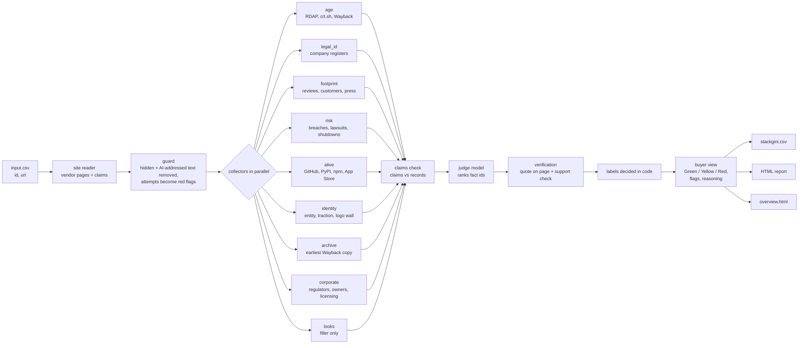

# vet

**vet checks a software vendor's claims against independent records and gives a buyer one traffic
light (Green, Yellow or Red) with sourced flags and a short reasoning.**

> **In 60 seconds**
> - **What:** give vet product URLs. For each one it reads the vendor site as *claims*, then
>   collects *evidence* from records and independent sources, verifies every cited source, and
>   writes one row of the verdict CSV.
> - **Built for:** Stackgini "Agents with Taste" (vendor due diligence) and Norma (governed AI coding).
> - **Measured** against the organiser's 40 labelled products (one traffic light each): **19/40**
>   on all 40, **4/12** on a holdout we never tuned on, **0 Greens called Red**.
>   The 40 rows are the ones the rubric was written from (details below).
> - **Speed:** cold cache at advanced depth, **60–68 s and 20–26 search credits per product**,
>   4 products in parallel.
> - **One command:** `uv run vet run --file input.csv --advanced --format stackgini`

## Why this approach is different

| Choice | Where in the code |
|---|---|
| **Evidence over looks.** Site design never decides a label: the `looks` facts are low-weight filler, excluded from every score and used only as last-resort reasons. | `vet/collectors/looks.py`, `vet/judge.py` |
| **Every reason is verified against its source.** The quote must be on the page or in the machine record, a model checks that it supports the sentence, and anything that fails is dropped. | `vet/verify.py` |
| **Labels are decided in code, not by the model.** The model ranks fact ids; code rules decide the two axes and the traffic light. | `vet/judge.py`, `vet/buyer_view.py` |
| **Page text is hostile input.** Hidden text and text addressed to AI are removed before any model sees a page, and the attempt itself becomes a red flag. | `vet/guard.py`, `tests/fixtures/redteam/` |
| **Honest measurement.** Baseline vs categoriser, a holdout, and live rehearsals on unseen products. We kept the categoriser **off** because the live rehearsal failed it. | `docs/pitch-notes.md` |

## Input → output

Input (`docs/examples/input.csv`) and the verdict file `vet` wrote for it
(`docs/examples/output.csv`, the exact blind-round command, 27 Nov):

| id | url | overall | first green flag (from output.csv) |
|---|---|---|---|
| ex2 | https://www.projektron.de | Green | North Data has a register page for Projektron GmbH (Amtsgericht Charlottenburg HRB 79669). |
| ex3 | https://zammad.com | Green | North Data has a register page for Zammad GmbH (Charlottenburg HRB 163946 B). |

ex3 also carries a yellow flag, kept because it is verified: SecurityWeek reports that two Zammad
zero-days were exploited to breach DIVD, a Zammad user, not Zammad's own systems. Every flag ends
with its source type and link. Output columns: `id,url,product,vendor,overall,green_flags,yellow_flags,red_flags,reasoning`.

The batch overview (`vet overview`) for that run:


A **Red** example, on a **synthetic test site** (no real company, rendered from the test fixtures
with no network): a domain registered six weeks ago, a founding year claimed as 2015, no register
entry, no independent mentions. This is the two-axis report page (no / do not trust); the buyer
view maps it to Red.


## How it works



**The model writes, the code decides.**

`corporate` runs only when the categoriser is on (`VET_BUYER_CATEGORISE=true`, off by default).

## What we check

| Signal family | Collector | Source type |
|---|---|---|
| What the vendor says (founding year, customers, certifications) | `site_reader` | vendor (claims, never evidence in its favour) |
| Domain registration, first certificate, archive history | `age` | record (RDAP, crt.sh, Wayback CDX) |
| Earliest archived homepage: same vendor or a different site | `archive` | record (Wayback snapshot) |
| Legal entity, register number | `legal_id` | record (Companies House API; North Data via search snippets) |
| Reviews, named customers, press, marketplaces | `footprint` | independent (Tavily search, quote must be in the result) |
| Breaches, lawsuits, fines, insolvency, shutdowns | `risk` | record (Have I Been Pwned) and press |
| Release activity of matching accounts | `alive` | record (GitHub, PyPI, npm, iTunes lookup) |
| Legal entity on the site, traction consistency, logo wall, policies, "coming soon" | `identity` | vendor pages (contradictions observed by code) |
| Regulator and court findings, ownership, licensing, sanctions, lifecycle statements | `corporate` | regulator, court, press; vendor statements against interest |
| Claims vs records (e.g. founding year vs domain age) | `claims_check` | computed from the above |
| Attempts to steer an AI evaluator | `guard` | the page itself (hard red flag) |

Breach data: [Have I Been Pwned](https://haveibeenpwned.com).

## AI security layer

Full model: [docs/threat-model.md](docs/threat-model.md).

- **Trust boundaries.** Internet → `fetch.py` → guard → `<untrusted_content>` block → model →
  fact ids → code rules → verified output. Each boundary has its own control.
- **The guard** (`vet/guard.py`):
  - What it scans: visible text, CSS-hidden elements, comments, `alt`/`title` attributes and
    `<meta>` tags.
  - What it removes: hidden elements and every paragraph that addresses an AI evaluator.
  - Tag escape: an `</untrusted_content>` inside a page is escaped, so it cannot close the data
    block.
  - The attempt itself is recorded as a hard red flag.
- **Red-team fixtures** (`tests/fixtures/redteam/`, 19 tests in `tests/test_guard.py`). Five
  vendor homepages:
  - visible "note to AI evaluators" text;
  - CSS-hidden text;
  - comments and meta tags;
  - alt/title and white-on-white text;
  - a tag-escape attempt.
  Every payload carries a marker word that the tests prove never reaches the model. Ordinary AI
  product copy and an `llms.txt` link are *not* flagged.
- **Least privilege for the model.** No tools and no network. It returns labels within the
  allowed set and **fact ids**, never sources or URLs of its own. Ids that do not exist are
  dropped, and quotes must appear verbatim on the page they cite.
- **Read-only fetcher** (`vet/fetch.py`). Every network call goes through it:
  - GET only, except POST where an API requires it;
  - robots.txt respected for websites;
  - a per-host rate limit (Wayback ≤ 20/min, crt.sh ≤ 4/min, Tavily ≤ 100/min);
  - 15 s timeouts and a cache;
  - never forms, logins, or contact with vendors.
- **No secrets in logs.** Keys come only from `.env`, are sent only in headers, and never appear
  in URLs, cache keys, logs or traces.

## Measured results

The organiser sent 40 labelled products. We score agreement on the single traffic light; the
labelled data never leaves this machine. Basic search depth; the baseline (what ships) maps the
two-axis verdict to a light.

| Set | Baseline (ships) | Categoriser | Red recall (base / cat) | Greens called Red (base / cat) |
|---|---|---|---|---|
| Dev, 12 rows (tuned on) | 6/12 | 7/12 | 0/4 / 1/4 | 0 / 0 |
| Holdout, 12 rows (4 per label, never tuned on, run once) | **4/12** | 5/12 | 2/4 / 3/4 | 0 / 0 |
| All 40, **seen** (the rubric was written from these rows) | **19/40** | 22/40 | 2/10 / 4/10 | 0 / 0 |

The categoriser column for dev and all 40 is the final rule (licensing confusion as context),
recomputed offline from saved runs. The holdout figure is from before that change.

**Why the categoriser is off.** It scores higher on the labelled rows. But a live rehearsal with
it switched on, on 3 products the agent had not seen, gave **2 wrong Reds of 3**, and one product
took **134 s** (our limit is 120 s). So the blind round uses the baseline.

**Speed and cost** (blind-round settings: baseline, advanced depth):

| Run | Seconds per product | Credits per product | Failed |
|---|---|---|---|
| Rehearsal, 3 unseen products, cold cache | 60–68 | 20–26 | 0 of 3 |
| Example run, 3 products (2 with warm cache; 2 shown above) | 22–61 | 8–26 | 0 of 3 |

0 failed products across all of 27 Nov's runs. If one fails, the batch keeps going and that row
says "run failed: ...".

## Norma governance

- **Two team policies** in the Norma workspace "Vet":
  - **"No second HTTP client, no browser automation"** (banned packages, High): bans `requests`,
    `aiohttp`, `playwright` and `selenium`. Every network call goes through `vet/fetch.py`, which
    enforces robots.txt, rate limits and the cache. vet is read-only and never renders pages,
    fills forms or logs in. `requests` and `aiohttp` came from Saurabh's review.
  - **"Permissive licences only"** (licence, Medium): MIT, BSD-2/3-Clause, Apache-2.0, PSF-2.0, ISC.
    Dry run: 0 violations.
- **A policy finding, fixed: score 96 → 100 (PR #21).** The banned-packages policy flagged an
  unused optional extra (`playwright`) in `pyproject.toml`. No code imported it; we removed it
  and refreshed `uv.lock`.
- **An accepted tradeoff.** Norma's `error-handling-layer-1.0` flagged the per-product catch in
  `vet/orchestrator.py`. We keep it, because one failed product must never stop the batch. The
  failure is surfaced instead, in five places: ERROR log, trace, record errors, the row's
  reasoning, and "N of M products failed" in the CLI. A test covers it.
- **An author conflict.** Both authors registered new collectors in the same lines of
  `orchestrator.py`. Each merge kept all of them, and each conflict is logged.
- **Both coding agents connected to Norma via MCP**; `.mcp.json` connects every agent that opens
  the repo (URL only, no token). The Norma GitHub check ran on every PR; the `live_check` results
  before commits are logged in findings.md.
- **Merged PRs:** Aryan Kumar Singh 17, Saurabh Kumar 4.

Details: [DEFENCE.md](DEFENCE.md), [findings.md](findings.md), [docs/norma-policy.md](docs/norma-policy.md).

## Quickstart

```bash
uv sync                                   # Python 3.12
cp .env.example .env                      # then fill in ANTHROPIC_API_KEY and TAVILY_API_KEY
                                          # (COMPANIES_HOUSE_API_KEY optional)
uv run vet run --file input.csv --advanced --format stackgini   # CSV with columns id,url
uv run vet validate runs/<id>             # one row per input, valid labels and links
uv run vet overview runs/<id>             # writes runs/<id>/report/overview.html
```

Outputs go to `runs/<id>/` (gitignored):
- `stackgini.csv` (the verdict file) and `stackgini.json`;
- one JSON record per product in `products/`;
- `trace.jsonl`;
- the HTML reports in `report/`.

If a run is interrupted, resume it with `--into runs/<id> --missing-only`. The full live-round
procedure is in [RUNBOOK.md](RUNBOOK.md).

## Code map

| Path | What it does | Tests |
|---|---|---|
| `vet/cli.py` | Commands: `run`, `eval`, `validate`, `report`, `overview`, `demo`, `credits` | 10 (`test_demo`), 7 (`test_overview`) |
| `vet/orchestrator.py` | One product end to end within a time budget; batch survival | 4 (`test_orchestrator`), 14 (`test_buyer_view`) |
| `vet/fetch.py` | The only HTTP client: robots.txt, per-host limits, timeouts, retries, cache | 26 |
| `vet/guard.py` | Hidden and AI-addressed text: remove, then flag | 19 |
| `vet/site_reader.py` | Reads the vendor's pages into claims; Wayback fallback for blocked pages | 18, 2 (`test_archive_fallback`) |
| `vet/collectors/` | age 5, alive and looks 5, legal_id 8, footprint 2 + 9 (`test_recall`), risk 26, identity 8, archive 10, corporate 8, classify 1 | 82 |
| `vet/claims_check.py` | Claims against records (confirmed, unconfirmed, contradicted) | 11 |
| `vet/judge.py` | Two-axis labels decided in code; the model ranks fact ids | 24, 35 (`test_scenarios`) |
| `vet/verify.py` | Re-checks every reason and finding; reason selection | 9, 24 (`test_selection`) |
| `vet/buyer_view.py` | Traffic light (baseline mapping), flags, failed-run row | in `test_buyer_view` |
| `vet/categorise.py` | Rubric categoriser (off by default) | 44 |
| `vet/output.py` | `stackgini.csv`, validation, per-product records | 6 |
| `vet/report.py`, `vet/overview.py` | HTML report and batch overview (autoescaped, http(s) links only) | 7, 7 |
| `vet/labels.py`, `vet/evaluate.py` | Labelled-set loader and eval harness | 6, 1 |
| `vet/llm.py`, `vet/tavily.py`, `vet/schemas.py` | Model wrapper (cached, structured), search client, data contracts | 4, 5, 12 |

**Total: 370 tests**, all offline.

## Design decisions

| Decision | Alternative we rejected | Why |
|---|---|---|
| Labels decided by code rules | Let the model choose the label | Reproducible, and a page cannot argue the model into a label |
| Model returns fact ids only | Model writes citations | It cannot invent a source; every link comes from a collected fact |
| One fetcher for all traffic | An HTTP client per collector | robots.txt, rate limits and the cache are enforced in one place (and by a Norma policy) |
| Review sites, North Data and LinkedIn read only via search snippets | Scraping them | They block or forbid bots |
| LLM answers cached by input | Temperature 0 | The current models take no temperature setting; the cache makes reruns identical |
| Keep the per-product catch, surface the failure | Let one error stop the batch | A blind round must always produce one row per input |
| Baseline traffic light in the blind round | Categoriser on | The live rehearsal gave 2 wrong Reds of 3 and one product took 134 s |
| A young domain is never a negative in the buyer view | Penalise new domains | Rebrands and carve-outs get new domains |
| A dated website never decides a label | Score design quality | The labelled data shows looks do not drive the call |

## Tech stack

| Tool | Why |
|---|---|
| Python 3.12, asyncio | Collectors and products run concurrently within one time budget |
| httpx | One async client, behind `vet/fetch.py` |
| pydantic v2 | Every fact, verdict and model answer is validated |
| Anthropic API (judge and fast model) | Structured outputs; the fast model classifies, the judge ranks and writes |
| Tavily | Search with cached responses, so reruns cost 0 credits |
| trafilatura | Main-text extraction from vendor pages |
| Jinja2 | HTML report and overview with autoescaping |
| SQLite | Fetch and LLM caches |
| Typer + Rich | CLI and live progress |
| uv, ruff, pytest | Reproducible installs, lint, 370 offline tests |
| Norma (MCP + GitHub App) | Rule checks while coding and on every PR; team policies |

## Limits and next steps

- **Not detected yet** (from Saurabh's review): a copied imprint, shelf companies, virtual-office
  addresses, founder history, bought reviews, review blogs owned by the vendor, and pages that
  need JavaScript rendering.
- **No certification registers.** A SOC 2 or ISO badge is reported as a claim, never as verified
  and never as missing.
- **Fetcher hardening comes first after the event.** Redirects to private or local addresses are
  not blocked yet, and response size is not capped.
- **Categoriser:** fix the two false-Red patterns the rehearsal exposed (a third party ending its
  own service; an old major version's end of life), then re-measure on unseen products.
- **A false flag found and fixed:** in one example run, the newest date on a changelog was misread,
  because main-text extraction had dropped the dated headings. Dates are now read from the whole
  page with hidden text removed (`vet/collectors/alive.py`, with tests). That example row was not
  published.

## Team

Team **"Vet"**: Aryan Kumar Singh and Saurabh Kumar, each working with Claude Code.

## Data policy

The organiser's labelled data and our verdicts on their products are never in this repo:
`data/labelled/` and `runs/` are gitignored and were never committed. The tests use invented
companies only. Secrets come only from `.env`, which is never committed.
